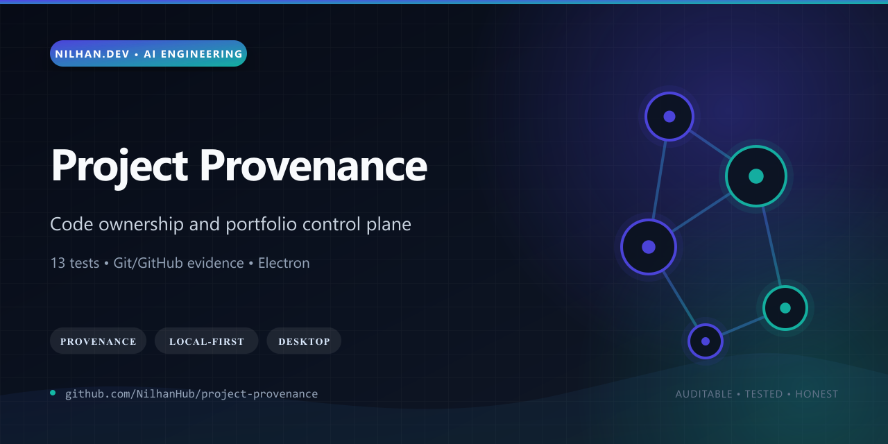
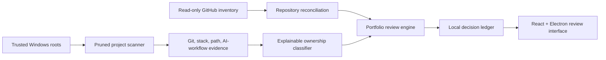

# Project Provenance

[](https://github.com/NilhanHub/project-provenance/actions/workflows/ci.yml)
[](LICENSE)
[](package.json)



Project Provenance is a local-first Windows control plane for answering a surprisingly hard engineering question: *which projects on a large development machine are original work, which are vendor copies or backups, and which are genuinely ready for a public portfolio?*

It combines a pruned filesystem crawler, Git authorship and remote analysis, stack detection, explainable ownership scoring, GitHub reconciliation, duplicate grouping, disclosure-risk gates, and a review ledger that records the final publication decision for every project.

## Why it stands out

- Scans large Windows roots while pruning dependency caches, build outputs, recycle bins, and inaccessible trees.
- Explains `Likely mine`, `Needs review`, and `Vendor` classifications with weighted, visible evidence.
- Reconciles local projects against authenticated GitHub inventory without publishing or changing repositories.
- Correlates Git, project structure, optional local Codex-session evidence, duplicate fingerprints, rights risk, and significance metrics.
- Keeps all inventory local; optional Gemini review receives only ambiguous metadata and a short README excerpt.
- Ships as both a React/Vite local web app and an Electron desktop application bound to `127.0.0.1`.
- The release passes lint, typecheck, **13 tests**, web build, and Electron main-process build with zero known npm advisories.



## Privacy model

The public repository contains a sanitized empty seed inventory. Real scan results, machine paths, local session evidence, and review artifacts live under the ignored `.project-provenance/` data area or the installed application's user-data directory. The crawler never edits, moves, commits, deletes, or publishes scanned projects.

## Quick start

```powershell
npm ci
npm run lint
npm test
npm run typecheck
npm run dev
```

Open `http://127.0.0.1:4173` and start a scan. The API service binds to loopback only.

## Portfolio audit

After a scan, the optional audit produces a complete review ledger:

```powershell
npm run audit:portfolio
```

By default it reads `.project-provenance/inventory.json` and writes reports under `.project-provenance/portfolio-audit`. Configure alternate paths or ownership identities with:

- `PROJECT_PROVENANCE_INVENTORY`
- `PROJECT_PROVENANCE_AUDIT_OUTPUT`
- `PROJECT_PROVENANCE_OWN_EMAILS` (comma-separated)
- `CODEX_SESSION_ROOT`

## Build the Windows application

```powershell
npm run build:desktop
npm run dist:win
```

The NSIS installer is written under `release/`. Its first launch starts from the sanitized seed and builds a private inventory for the current user.

## Local API

- `GET /api/projects` — inventory and scan state
- `POST /api/scan` — scan explicitly trusted roots
- `GET /api/scan/status` — progress
- `POST /api/scan/cancel` — cancellation request
- `POST /api/open-folder` — open a discovered path in Explorer
- `PUT /api/portfolio-reviews/:projectId` — persist a review decision

## Maturity and boundaries

Ownership classification is decision support, not legal proof. Corporate/client rights still require human clearance, optional session correlation depends on locally available evidence, and filesystem scans can encounter inaccessible or changing paths. GitHub access is read-only unless a separate publication workflow is explicitly authorized outside this application.

See [SECURITY.md](SECURITY.md), [CONTRIBUTING.md](CONTRIBUTING.md), and [RIGHTS.md](RIGHTS.md).
